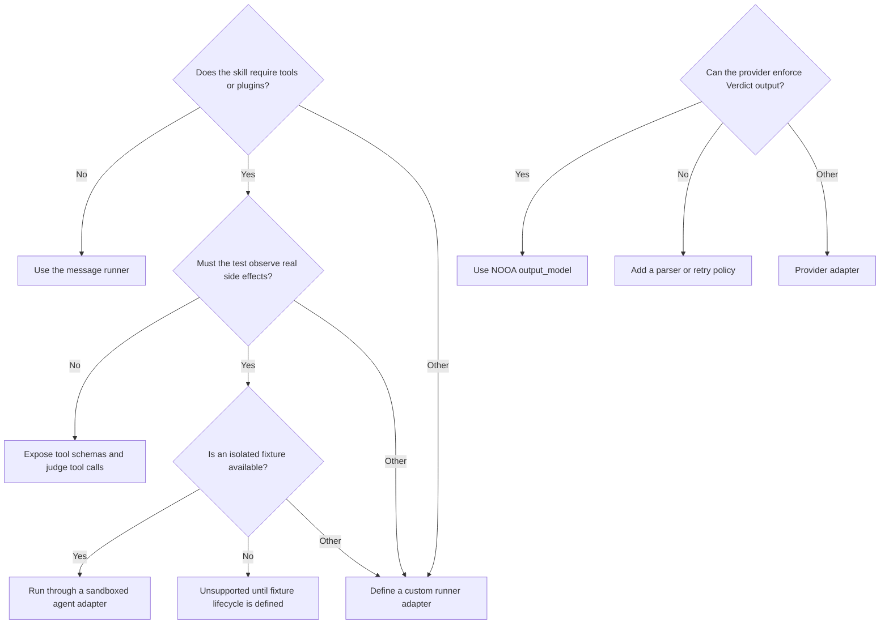

# Skilltester spec

## Agreement

- Everything is Python: package, configuration, examples, and results.
- NOOA supplies model clients; no YAML registry or DSPy.
- `config.py` exports only `llm`.
- `llm` is either one NOOA client used for both roles or exactly
  `{"candidate": client, "judge": client}`.
- `examples.py` exports `system_prompt`, `response_types`, and `examples`.
- Each example is
  `{"prompt": str | messages, "expected_response_type": response_type, "tags": {...}}`;
  `tags` is optional.
- `examples.py` may define `Tags` as a `TypedDict` whose required fields use
  string `Literal` values. If present, every example must supply exactly those
  tag keys and allowed values.
- The four response types are `answer`, `executed`, `answer_then_execution`, and
  `execution_then_answer`.
- The candidate receives one system message: `system_prompt` plus `SKILL.md`.
- Skilltester gives the judge its internal classification instruction, the
  response-type definitions, the conversation, and the actual response.
- The judge returns only the classified response type.
- Every example is an independent async pipeline: candidate, then judge.
- All pipelines start together. A judge starts when its candidate finishes.
- Skilltester compares the classified type with the example's expected type.
- Reports include results and, when `Tags` exists, its derived options and score
  summaries grouped by tag.
- Matching is exact unless `examples.py` exports an optional nested
  `truth_table[expected][observed] = score` with values from `0.0` to `1.0`.
- CLI paths are optional. From the current directory, Skilltester discovers
  exactly one `SKILL.md` and one matching `config.py`/`examples.py` pair.
- Explicit `--skill`, `--config`, and `--examples` paths override discovery.

## Current boundary

The first version tests message-in/message-out behavior. It does not execute tools or observe side effects.

## Open questions

Dependent questions:

1. If plugins are supported, who installs and configures them?
2. If real effects are observed, who creates, resets, and destroys each fixture?
3. If tool traces are judged, what common trace format spans NOOA agents and other runtimes?
4. Should one failed request abort the run, or become an error verdict?
5. Should retries and repeated trials be package policy or ordinary Python in `config.py`?
